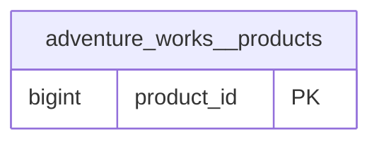
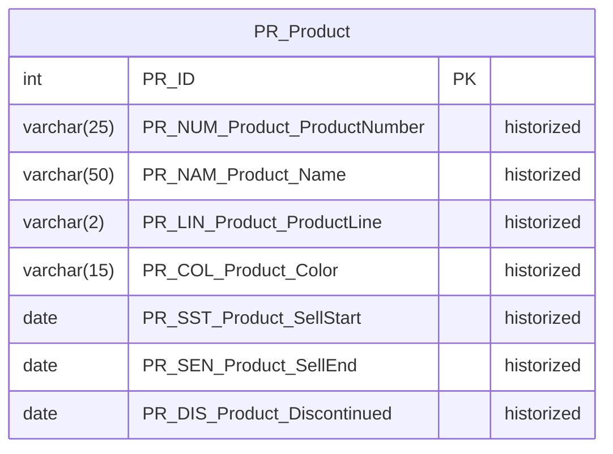
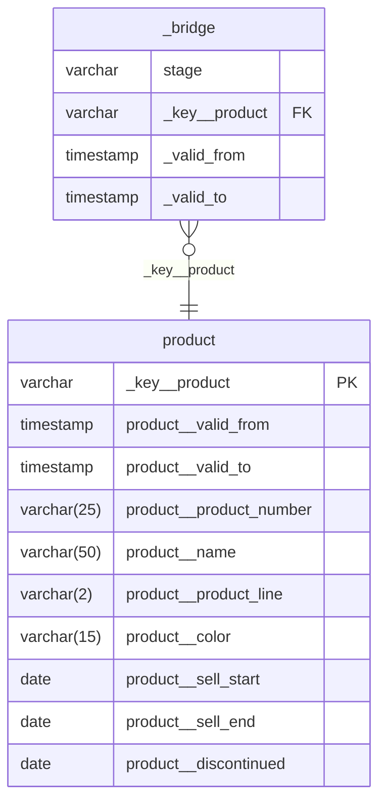

# declarative-data-platform

Declarations in, a Unified Star Schema out. A source is declared once: what ingest lands
(`sources/`), its data contracts and its Anchor model. Generators turn the declarations into
dbt models, and dbt builds them into DuckDB:

```
lake (dlt, Parquet)  ->  raw  ->  conform  ->  integrate (Anchor, crt)  ->  serve (USS)
```

| layer | what it is | declared in | written by |
|---|---|---|---|
| ingest | one dlt pipeline per resource, landing each row as JSON in hive-partitioned Parquet | `sources/<source>/` | `uv run ingest` |
| raw, conform | a view over the lake, and a staged model appending every load, typed by its ODCS v3 contract | `contracts/<source>/` | `uv run conform generate` |
| integrate | a concurrent-reliance-temporal Anchor model in Roenbaeck's naming, with its load log, integrity checks and schema tracking | `anchor/model.yaml`, `anchor/mappings/` | `uv run integrate generate` |
| serve | a Puppini Unified Star Schema: staged bridges, dimensions with ghost rows, the bridge | `anchor/model.yaml` | `uv run serve generate` |

## The model

Each layer's logical model, drawn by its generator from the declarations; `uv run task check`
fails when a diagram no longer matches them. Edit around the diagrams, never inside the
markers.

### Conform

The staged models, one per contract, with their primary keys.

<!-- erd:conform begin: written by `uv run conform generate` -->

<!-- erd:conform end -->

### Integrate

The anchors, with their identities and attributes in Anchor Modeling's own naming.

<!-- erd:integrate begin: written by `uv run integrate generate` -->

<!-- erd:integrate end -->

### Serve

The Unified Star Schema: each dimension, and the bridge that joins them.

<!-- erd:serve begin: written by `uv run serve generate` -->

<!-- erd:serve end -->

## Run it

```sh
uv sync
uv run task ingest                  # land every declared resource under ./lake (or $LAKE_ROOT)
uv run task generate                # regenerate every layer's models
uv run task check                   # fail if committed models or diagrams drifted from the declarations
uv run task build                   # build warehouse/dev.duckdb (TARGET=prod for the other)
uv run task simulate                # append a changed copy of the latest Products load (the feed is static)
```

`uv run simulate --seed N --loads K` appends K seeded, changed loads to the lake: edits,
corrections, source nulls, late arrivals, new products and products dropping out of a load. On an
empty lake it lands a committed snapshot of the feed first, so a seed always gives the same lake;
CI builds against seed 7 (ADR-0027).

`uv run ingest --list` names the declared sources, and `uv run ingest SOURCE` (or
`SOURCE__RESOURCE`) lands one; it exits 0 when everything it ran landed, 1 when some resource
failed, 2 when none landed or the name is not declared (ADR-0018); through go-task, `task -x ingest:source -- SOURCE` keeps those codes, where plain `task` turns any failure into 201. Adding an object to a source is one file in
`sources/<source>/`, written as dlt's `rest_api` resource configuration (ADR-0016).

### On a schedule

`orchestrate/` runs the platform hourly with Prefect: a `run` flow lists the sources, ingests
each in its own flow run (its own process on a local work pool), then builds `prod` once if any
source landed. It ends Failed, naming the source, when anything did not land (ADR-0022). Every
step is a Taskfile task, so another orchestrator could call the same ones (ADR-0020).

This repo declares what runs and when: the flows and `orchestrate/prefect.yaml` (deployments,
the `0 * * * *` UTC schedule, one run and one build at a time). The infra provides the Prefect
server, a work pool and its workers. Flow runs start in the directory the deploy ran from, so
those workers need the repo at that same path, with the lake and the DuckDB file beside it, and
the pool must admit one flow run more than there are sources (A18). Kubernetes pods, which
would need the repo and shared storage brought to them, are not set up yet (ADR-0024). To run it on your machine, with three terminals in the repo root:

```sh
uv run task orchestrate:server                       # 1: a local Prefect server on :4200

export PREFECT_API_URL=http://127.0.0.1:4200/api     # 2 and 3
export ORCHESTRATE_WORK_POOL=local
uv run task orchestrate:worker                       # 2: a process worker; creates the pool

uv run task orchestrate:deploy                       # 3: deploy run, ingest-source, build
uv run prefect deployment run run/run                #    optional: one run now, not at hh:00
```

The UI at http://127.0.0.1:4200 shows each run, its sources and its build. Against the
infra's server, set `PREFECT_API_URL` and `ORCHESTRATE_WORK_POOL` to its values and run
`orchestrate:deploy` from the checkout its workers use. Scheduled runs never regenerate models: that stays a commit-time act.

`uv run task --list` shows every task. Integrate ignores `--full-refresh` and builds incrementally:
its history is only appended to (ADR-0006).

The first business question it answers: how many products were on sale on a given day,
per product line and colour? It reads each product's version valid on that day; the first
version reaches back to 0001-01-01 (ADR-0011):

```sql
select product__product_line, product__color, count(*)
from serve__uss.product
where _key__product like '%|%'
  and product__valid_from <= timestamp '2013-06-01' and timestamp '2013-06-01' < product__valid_to
  and product__sell_start <= date '2013-06-01'
  and (product__sell_end is null or product__sell_end >= date '2013-06-01')
  and (product__discontinued is null or date '2013-06-01' < product__discontinued)
group by all;
```

## Read next

- `CLAUDE.md`: how the work is done here.
- `docs/adr/`: the decisions, in Nygard's format.
- `docs/lexicon.md` and `docs/assumptions.md`.
